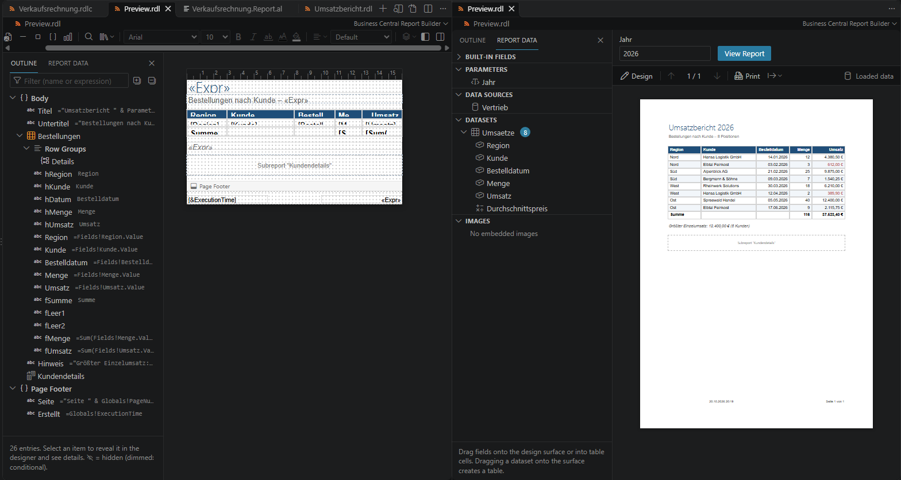

# Business Central Report Builder

Visueller Designer für RDLC-Layouts von Business-Central-Berichten (`.rdlc`, auch `.rdl`) in VS Code, angelehnt an den
Microsoft Report Builder, mit der **Dokumentgliederung**, die es sonst nur im Berichts-Designer von Visual Studio gibt,
und mit dem **AL-Report als Datenquelle**.



## Installation

Die Extension wird als VSIX über die [GitHub Releases](https://github.com/strxngewxrld/report-builder/releases) verteilt:
Die Datei `bc-report-builder-<version>.vsix` des neuesten Releases herunterladen und in VS Code **Extensions: Install from
VSIX…** ausführen, oder:

```sh
code --install-extension bc-report-builder-1.0.0.vsix
```

Voraussetzung ist VS Code 1.95 oder neuer. Das Paket enthält alle Laufzeitabhängigkeiten.

Im eingeschränkten Modus sind Entwurf und Vorschau verfügbar. Für Projekt-Build, Symbol-Download und das Ausführen
von Berichten in Business Central muss dem Arbeitsbereich vertraut werden.

**Updates**: Beim Start prüft die Extension, ob in den GitHub Releases eine neuere Version liegt, und bietet dann
*Installieren* (lädt die VSIX, prüft die SHA-256-Prüfsumme von GitHub und installiert sie), *Release öffnen* oder *Diese
Version überspringen* an. Dabei wird nur die öffentliche GitHub-API abgefragt; es werden keine Daten gesendet. Abschalten
lässt sich das mit `bcReportBuilder.checkForUpdates`.

## Business Central

### AL-Report als Datenquelle
Das Dataset eines BC-Layouts erzeugt der AL-Compiler aus dem Report-Objekt. Der Designer findet den AL-Report, der das
Layout verwendet (`rendering › layout › LayoutFile` oder `RDLCLayout`, auch in Report-Extensions), und zeigt unter
*Berichtsdaten* statt SSRS-Datenquellen:

- **Datenelemente und Spalten** als Baum – auf die Fläche oder in Zellen ziehen, Doppelklick öffnet die Definition im AL-Code
- **Labels und Beschriftungen** (`labels`, `IncludeCaption` → `<Spalte>Caption`) als Parameter
- **„Build nötig“** bei Spalten/Labels, die das Layout-Dataset noch nicht enthält (Projekt erstellen, dann aktualisiert der Compiler das Layout)

Datenquellen-, Dataset- und Parameter-Dialoge sind für BC-Layouts ausgeblendet.

### AL-Report aus dem Designer bearbeiten
Was Report Builder und Visual Studio nicht können, weil sie den AL-Report nicht kennen:

- **Felder als Spalten hinzufügen…** (Datenelement in *Berichtsdaten*, Kontextmenü oder ＋): Auswahl aus den Feldern der Tabelle –
  aus Tabellen und Tabellenerweiterungen im Workspace und aus den Symbolpaketen (`.alpackages/*.app`, z. B. Base Application).
  Die Spalten werden nach Base-App-Konvention benannt (`UnitPrice_Line`) und in das Datenelement bzw. in Report-Extensions in
  `add(…)` eingefügt.
- **Als AL-Label anlegen…** (Kontextmenü eines Textfelds mit festem Text): legt das Label im `labels`-Block an (bei Bedarf neu)
  und setzt das Textfeld auf `=Parameters!<Label>.Value` – übersetzbar wie in der Base App.
- **Projekt erstellen** (`AL: Package`) direkt aus dem Designer, wenn das Layout-Dataset veraltet ist
- **Report in Business Central ausführen** (Editor-Titelleiste): öffnet den Report im Web-Client der Umgebung aus `.vscode/launch.json`
  (Cloud, Docker, On-Prem), optional nach dem Veröffentlichen
- **CodeLens im AL-Code**: an jeder Spalte und jedem Label „n× im Layout“ – Klick öffnet den Designer und wählt das Textfeld; am Report
  „Layout im Designer öffnen“
- **Kontextmenü in *Berichtsdaten***: *Zur Definition wechseln*, *Ausdruck kopieren* (`=Fields!…Value`)
- **Spalte umbenennen (AL und Layouts)…** (im AL-Editor auf dem Spaltennamen oder in *Berichtsdaten*): ändert die Spalte im
  AL-Report und in allen RDLC-Layouts des Reports und seiner Report-Extensions – Feldverweise, `<Spalte>Format`,
  `<Spalte>Caption`, die Dataset-Deklaration und gleichnamige Textfelder; ein Rückgängig macht alles rückgängig
- **Labels für Übersetzer**: beim Anlegen optional `Comment`, `MaxLength` und `Locked`; Hinweis auf die XLIFF-Dateien
  (`TranslationFile` in `app.json`, Sprachdateien unter `Translations/`). Label und Textfeld ändern sich in einem Schritt –
  ein Rückgängig nimmt beides zurück
- **Layouts des Reports** in *Berichtsdaten*: alle Layouts des Reports und seiner Report-Extensions; RDLC-Layouts öffnen im
  Designer, Word- und Excel-Layouts in Word bzw. Excel (der Designer bearbeitet sie nicht), fehlende Dateien sind markiert

### BC-Konventionen beim Gestalten
- Felder mit `<Spalte>Format` (Dezimalspalten) bekommen beim Ziehen `Format = =Fields!<Spalte>Format.Value` und werden rechtsbündig
- Kopfzellen bekommen die übersetzte Beschriftung `=Parameters!<Spalte>Caption.Value` (IncludeCaption) statt eines festen Texts
- Datenelemente lassen sich als Tabelle auf die Fläche ziehen; `…Format`-Hilfsfelder werden dabei ausgelassen

### Prüfung (Problembereich)
Für alle Layouts im Workspace, bei jeder Änderung:

| Meldung | Schwere |
|---|---|
| `Fields!`, `Parameters!`, `Code.`, `ReportItems!` verweist auf etwas, das es nicht gibt (mit Hinweis bei falscher Groß-/Kleinschreibung) | Fehler |
| Spalte/Label ist im AL-Report, aber noch nicht im Layout-Dataset | Warnung |
| Feld/Parameter ist im Layout, aber nicht mehr im AL-Report (fällt beim nächsten Build weg) | Warnung |
| Layout-Dataset insgesamt veraltet | Hinweis |
| AL-Spalte bzw. Label wird in keinem RDLC-Layout verwendet (im AL-Editor ausgegraut; nur wenn alle Layouts des Reports RDLC sind) | Hinweis |
| Dezimalfeld ohne Zahlenformat, obwohl BC `<Spalte>Format` liefert | Information |
| Fester Text in einem BC-Layout (wird nicht übersetzt – als Label anlegen) | Information |

Die Funde erscheinen auch in der Dokumentgliederung am betroffenen Element.

### Vorschau
Die Vorschau wertet das RDL wie der Berichtsserver aus – auch die gruppierten Tablix-Bereiche typischer BC-Layouts:
Gruppen und Details, verschachtelte Tablixe, Filter, Sortierung, Kopfzellen, `ColSpan`, Sichtbarkeit (auch je Gruppe),
Rahmen je Seite, Textläufe mit eigener Formatierung, Datenbank- und eingebettete Bilder.

- **Seitenumbruch** nach Seitengröße und Rändern, Gruppenumbrüche (`PageBreak`), `KeepTogether`, wiederholte Kopfzeilen (`RepeatOnNewPage`), `ResetPageNumber`
- **Seitenkopf/-fuß je Seite**: Seitenzahlen, `ReportItems!` der Seite, `First/Last(ReportItems!…)`
- **Messgeräte** (rund und linear) mit Skala, Bereichen und Zeiger
- **`<Code>`-Block** wird interpretiert (VB-Teilmenge, auch `For`/`For Each`/`While`/`Do`-Schleifen, `Select Case`, `Try`/`Catch`/`Finally`, `With` und Arrays): `BlankZero`…, `SetData`/`GetData` (der Seitenkopf sieht den Stand seiner Seite), `IsNewPage`/`GetGroupPageNumber`, `SetRowColor`, `CalcPct` und eigene Funktionen
- Ausdrücke: Aggregate inkl. Bereich und `RunningValue`, `Previous`, `RowNumber`, `IIf`/`Switch`/`Choose`, Text-, Datums- und Formatfunktionen, `Convert.*`, `System.String.*`, `Math.*`, .NET-Formatcodes
- **Daten**: *Berichtsdaten › Vorschaudaten laden* liest **Excel** (z. B. aus BC: Report ausführen › *Senden an › Microsoft Excel-Dokument (nur Daten)*), CSV oder JSON; gespeichert als `<Layout>.data.json`. Ohne Daten erzeugt die Vorschau Beispielzeilen entlang der AL-Datenelemente (Kopf- und Zeilendatensätze wie im echten BC-Dataset).
- **PDF-Export** direkt aus der Vorschau (Text, Rahmen, Hintergründe als Vektoren; Bilder und Diagramme eingebettet; die
  installierten TrueType-/OpenType-Schriften des Berichts als Teilmenge eingebettet, mit allen Unicode-Zeichen der Schrift);
  **Drucken** öffnet die paginierte Vorschau im Browser; Export als HTML, Excel und Word

### Tabellen, Gruppen, Listen und Matrizen
Alle Tablix-Bereiche der 379 Base-App-Layouts sind im Designer bearbeitbar – auch die BC-typische Belegliste (gruppierte
Tablix, je Beleg ein Rechteck mit Kopfdaten und der verschachtelten Zeilentabelle):

- **Gruppen**: *Übergeordnete/Untergeordnete Gruppe hinzufügen*, Gruppenkopf/-fuß, Gruppe löschen (mit oder ohne Zeilen),
  Gruppeneigenschaften (Gruppierung, Sortierung, Filter, Seitenumbruch mit „Seitenzahl je Gruppe neu“, Ausblenden, Umschalten)
- Bereich **Gruppierung** unter der Entwurfsfläche (Zeilen- und Spaltengruppen wie in Report Builder), Gruppenklammern an den Zeilen
- **Zeilen** innerhalb/außerhalb der Gruppe einfügen, löschen; Zeileneigenschaften *Auf jeder Seite wiederholen*,
  *Bei Gruppe halten*, *Ausblenden*, *Umschalten durch*
- **Zellen verbinden/teilen**; Spalten einfügen/löschen berücksichtigt verbundene Zellen
- **Listen**: Felder auf das Rechteck einer Listenzelle ziehen legt dort ein Textfeld an; Elemente darin sind verschiebbar
- **Matrix einfügen** (Zeilen-/Spaltengruppe, Wert, Gesamtzeile/-spalte); Kopfzellen und Ecke sind normale Textfelder
- **Diagramm einfügen** und *Diagrammeigenschaften*: Typ (Säulen, auch gestapelt und 100 %, Balken, Linie, geglättete Linie,
  Fläche, gestapelte Fläche, Punkte, Kreis, Ring, Trichter, Pyramide, Bereich, Bereichssäulen/-balken, Polar, Netz), Kategorie,
  Reihen mit eigenem Typ (Kombidiagramm) und zweiter Werteachse, Farbe der Datenpunkte (auch als Ausdruck je Punkt),
  Markierungen, berechnete Reihen (gleitende Durchschnitte, Mittelwert, Median – gestrichelt), Achsen (Titel, Zahlenformat,
  Minimum/Maximum), Datenbeschriftungen, Titel, Legende, Palette; bestehende Diagramme werden gezielt gepatcht, alles andere
  bleibt wortgleich
- **Spaltengruppen** zu Tabellen und Matrizen hinzufügen (*Gruppe hinzufügen › Spaltengruppe*) – auch zu Tabellen mit
  Spaltenköpfen und um bestehende Spaltengruppen herum (neue Kopfebene, die Ecke wächst mit) – und löschen (nur Gruppe oder
  mit Spalten); Spalteneigenschaften *Ausblenden* und *Umschalten durch*
- **Textteile**: Textfelder mit mehreren formatierten Teilen (z. B. „Seite **1**“) – jeder Teil mit Text/Ausdruck und Formatierung;
  *Textteile › Aufteilen* zerlegt ein Textfeld (`="Seite " & Globals!PageNumber` → zwei Teile), *In einfaches Textfeld* fasst sie
  wieder zusammen
- **Aktionen** an Textfeldern und Bildern: *Gehe zu URL*, *Gehe zu Lesezeichen*, *Gehe zu Bericht* (Drillthrough mit Parametern)
  und das Lesezeichen des Elements; in der Vorschau öffnen Links extern (nur http/https/mailto) und Lesezeichen-Links springen
- **Eingebettete Bilder** (z. B. Firmenlogo) unter *Berichtsdaten › Bilder*: einbetten (PNG, JPEG, GIF, BMP, SVG), umbenennen
  (Bildelemente werden angepasst), löschen, auf die Fläche ziehen; im Designer sichtbar

### Quellerhaltendes Speichern
Damit Layouts in Git kleine, nachvollziehbare Diffs ergeben: Unveränderte Elemente werden wortgleich geschrieben;
bearbeitete behalten alle nicht modellierten Inhalte (`Visibility`, `ZIndex`, Seitenrahmen …), die Stil-Ebene jeder
Eigenschaft, die Elementreihenfolge, Attribute wie `EvaluationMode` und die Maßeinheit (`pt`/`in`/`cm`).
Schema-Version, `MustUnderstand`, `rd:ReportUnitType` (auch `Invalid`), Zeilenenden und BOM bleiben erhalten.

## Ausdrücke, Verwendungen und Layout-Bausteine

Die **Lupe** im Designer öffnet *Ausdrücke und Verwendungen…*: Suchen/Ersetzen im gesamten Layout, einschließlich
Stilen, Gruppen und unverändert gespeicherten Elementen. Vorher/Nachher-Vorschau, einzelne Treffer oder alle ersetzen;
eine Sammelersetzung ist ein Rückgängig-Schritt. Im Modus *Feld- und Labelverwendungen* zeigt die Auswahl eines Felds
oder AL-Labels seine Verwendungen mit Elementname, Eigenschaft und Pfad; *Im Layout anzeigen* springt zum Element.
Feste Texte und AL-Quelltext werden nicht verändert.

Über das **Bibliothek-Symbol** lassen sich ausgewählte Elemente als Baustein speichern und in anderen Reports einsetzen,
z. B. Firmenkopf, Adressblock oder Fußzeile. Die Bibliothek bleibt im VS-Code-Profil erhalten; Export/Import als RDLC-Datei
ermöglicht die Weitergabe. Beim Einfügen sind Abschnitt und Position wählbar. Namen und interne Verweise werden angepasst;
benötigte eingebettete Bilder und verwendeter Berichtscode werden übernommen. Abweichender Code oder gleichnamige Bilder
mit anderem Inhalt werden nicht überschrieben. Fehlende Felder, Labels oder Datasets werden vorab angezeigt und müssen
im Zielreport ergänzt oder die Ausdrücke angepasst werden. Datenquellen und AL-Datasets werden nicht übertragen.

Die Vorschau berücksichtigt Umbrüche vor/nach Rechtecken und Datenbereichen sowie bedingte Gruppen-Umbrüche
(`Disabled`, `ResetPageNumber` als Ausdruck); „Am Ende“ gilt auch für die letzte Gruppeninstanz. Seiten werden nach dem
Laden der verwendeten Schriften neu vermessen.

Die drei Funktionen sind auch über die Befehlspalette verfügbar. Ein manueller Abnahmeplan unter `docs/ABNAHME.md`
beschreibt die Abläufe und erwarteten Ergebnisse.

## Dokumentgliederung
Registerkarte links: Seitenkopf / Text / Seitenfuß → Berichtselemente → Zeilen-/Spaltengruppen → Zellinhalte, beliebig
tief. ⊘ ausgeblendet, ◐ bedingt ausgeblendet; Gruppen mit Gruppierung, Filter, Sortierung, Seitenumbruch; Suche über
Namen und Ausdrücke; Auswahl synchron mit der Entwurfsfläche; Pfeiltasten wie in einem Baum.

## In VS Code integriert
Der Designer verhält sich wie ein eingebauter Editor:

- **Editor-Titelleiste**: *Einfügen* (Untermenü), *Vorschau anzeigen* / *Entwurf anzeigen*, *Drucken*, *Als XML öffnen*; im „…“-Menü
  *Ansicht* (Gliederung, Berichtsdaten, Eigenschaften, Lineal, Raster, Am Raster ausrichten – mit Häkchen), Zoom, Berichtseigenschaften,
  Seitenkopf/-fuß, Vorschaudaten laden, AL-Report öffnen. Im XML-Editor eines Layouts führt *Im Designer öffnen* zurück.
- **Native Kontextmenüs** auf der Entwurfsfläche (Text/Ausdruck bearbeiten, Untermenü *Tabelle*, Zwischenablage, Anordnen, Einfügen, Seitenkopf/-fuß),
  in der Gliederung (wie auf der Fläche) und in den Berichtsdaten (*Zur Definition wechseln* im AL-Code, *Ausdruck kopieren*,
  *Bearbeiten…*, *Löschen*, *Vorschaudaten laden*)
- **Statusleiste** (nur solange der Designer aktiv ist): Auswahl bzw. Einfügewerkzeug, Seite *x von y* in der Vorschau,
  Maßeinheit (Klick: ändern), Zoom (Klick: Auswahl), AL-Report (Klick: öffnen). Probleme zeigt VS Code selbst an.
- **Tastatur**: F5 Entwurf/Vorschau, ⌘⌥= / ⌘⌥- / ⌘⌥0 (Strg+Alt unter Windows/Linux) Zoom, Strg/⌘ + Mausrad zoomt; alle Befehle auch in der Befehlspalette
- **Einstellungen** (`bcReportBuilder.designer.*`): Raster, Am Raster ausrichten, Lineal, Standard-Zoom
- **Explorer**: *Neues Berichtslayout…* im Kontextmenü von Ordnern und unter *Datei › Neue Datei…*; *Im Designer öffnen* / *Als XML öffnen* bei Layouts
- Oberfläche aus Codicons und den Farben des aktiven Farbdesigns (hell, dunkel, hoher Kontrast): Symbolleiste, Bereiche mit
  ziehbaren Trennern, Bäume mit Einrückungslinien, Filterfeld, Dialoge, Bildlaufleisten

## KI-Unterstützung (GitHub Copilot)
Die Extension stellt Werkzeuge für den Agentenmodus von Copilot (und jeden anderen Chat, der `vscode.lm`-Tools nutzt)
bereit. Damit kann die KI Berichte vollständig bauen – mit der Logik des Designers statt durch Raten im XML. Im Chat lassen
sie sich auch direkt ansprechen, z. B. `#reportLayout` oder `#previewReport`.

Die Aufteilung folgt dem, was im XML leicht bzw. fehleranfällig ist:

| Direkt im XML (die KI editiert die Datei) | Werkzeug |
|---|---|
| Wert/Ausdruck eines Textfelds, `<Style>` (Schrift, Farbe, Format, Ausrichtung, Rahmen), `<Hidden>`, Position einzelner Elemente, `<Code>`-Block | – |
| Überblick mit Namen und **XML-Zeilennummern** jedes Elements, Seiten-/Breitenprüfung, Datasets | `bcReport_inspectLayout` |
| Prüfung nach jeder Änderung: XML (auch falsch geschachtelte Tags), Verweise, Namen, Leerseiten, `Fields!` im Seitenkopf, Ausdrücke, Vorschau-Fehler | `bcReport_validateLayout` |
| Ergebnis als Text: Werte, Tabellen zeilenweise mit Gruppen/Summen, Diagrammreihen | `bcReport_previewReport` |
| AL-Report: Datenelemente, Spalten (schon im Dataset?), Labels, Vorschaudaten, Felder der Tabellen aus den Symbolen | `bcReport_getReportData` |
| Neue Elemente mit eindeutigen Namen: Textfeld, Rechteck, Linie, Bild (aus Datei eingebettet), Tabelle aus Feldern mit BC-Konventionen, Matrix, Diagramm | `bcReport_insertItems` |
| Tablix-Struktur: Spalten, Zeilen, Gruppen (Eltern/Kind, Kopf/Fuß, Sortierung, Filter, Umbruch), Spaltengruppen, Zellen verbinden/teilen | `bcReport_editTable` |
| Diagramm lesen/ändern (Typ, Reihen, Kategorie, Achsen, Legende) | `bcReport_editChart` |
| Ausrichten, gleiche Größe, verteilen, zentrieren, Reihenfolge, löschen | `bcReport_arrangeItems` |
| Seitengröße, Ränder, Textkörper, Seitenkopf/-fuß, Einheit | `bcReport_setPageLayout` |
| AL-Spalten / AL-Label anlegen, Spalte in AL und allen Layouts umbenennen, Projekt erstellen | `bcReport_addAlColumns`, `bcReport_createAlLabel`, `bcReport_renameColumn`, `bcReport_buildProject` |
| Ergebnis im Designer zeigen (Element auswählen, Vorschau) | `bcReport_showInDesigner` |

Alle Layout-Änderungen sind normale Bearbeitungen des Dokuments: Ein offener Designer lädt sie sofort, *Rückgängig* nimmt sie
zurück, und Layouts ohne ungespeicherte Änderungen werden wieder gespeichert. Werkzeuge, die AL-Code ändern oder den Compiler
starten, fragen vorher nach. Für realistische Vorschauen kann die KI die Datei `<Layout>.data.json` mit Beispieldaten schreiben.

## Vergleich mit Report Builder und Visual Studio

| | Report Builder | Visual Studio (RDLC-Designer) | Diese Erweiterung |
|---|---|---|---|
| Textfeld, Tabelle, Bild, Linie, Rechteck | ✓ | ✓ | ✓ |
| Zeilengruppen (über-/untergeordnet), Gruppenkopf/-fuß, Sortierung, Filter, Seitenumbruch | ✓ | ✓ | ✓ |
| Zeilen innerhalb/außerhalb der Gruppe einfügen, Zellen verbinden/teilen | ✓ | ✓ | ✓ |
| Listen (Rechteck je Gruppeninstanz, z. B. BC-Belege), verschachtelte Tabellen | ✓ | ✓ | ✓ |
| Matrix (Spaltengruppen, Kopfzellen, Ecke, Gesamtzeile/-spalte) | ✓ | ✓ | ✓ |
| Diagramme (Säule, Balken, Linie, Fläche, Punkte, Kreis, Ring; gestapelt, 100 %, Kombi, zweite Achse) | ✓ (mehr Typen) | ✓ (mehr Typen) | ✓ anlegen, bearbeiten, Vorschau |
| Messgerät | ✓ | ✓ | erhalten, Vorschau |
| Karte, Unterbericht-Vorschau | ✓ | ✓ | erhalten, Platzhalter |
| Aktionen (Hyperlink, Lesezeichen, Drillthrough), eingebettete Bilder | ✓ | ✓ | ✓ |
| Textfelder mit mehreren formatierten Textteilen | ✓ | ✓ | ✓ Textteil-Editor |
| Ausrichten, gleiche Größe, Abstände, im Container zentrieren | eingeschränkt | ✓ (Format-Menü) | ✓ |
| Sichtbarkeit, Drilldown (ToggleItem), interaktive Sortierung | ✓ | ✓ | ✓ inkl. Vorschau |
| Ausdruckseditor mit Vervollständigung | Kategorien | IntelliSense | Vervollständigung inkl. AL-Herkunft der Spalten und Code-Funktionen |
| `<Code>`-Block | Textfeld | Textfeld | VS-Code-Editor mit VB-Hervorhebung, Prüfung im Problembereich |
| Dokumentgliederung | – | ✓ | ✓ mit Suche, Ausblenden-Markierung, Problemen |
| Vorschau | mit Datenquelle | nur mit Datenquelle im Projekt | mit Excel-Export aus BC oder generierten BC-Daten |
| Export | PDF, Word, Excel, … | PDF, Word, Excel | PDF, Excel, Word, HTML, Drucken |
| AL-Report als Datenquelle, „Build nötig“ | – | – | ✓ |
| Spalten/Labels im AL-Report anlegen, Felder aus Symbolen | – | – | ✓ |
| Spalte in AL und allen Layouts umbenennen | – | – | ✓ |
| BC-Konventionen (Format-/Caption-Felder), Prüfung gegen AL | – | – | ✓ |
| AL ↔ Layout navigieren (CodeLens, Definition), Report in BC ausführen | – | – | ✓ |
| Quellerhaltendes Speichern (kleine Git-Diffs) | – | – | ✓ |

## Weitere Funktionen
- Entwurfsfläche mit Lineal, Raster und Ausrichten, Seitenkopf/-fuß, Größe von Abschnitten und Breite ziehbar
- Textfeld, Tabelle (Kopf-/Detail-/Fußzeile, Spalten einfügen/löschen, Breiten ziehen), Bild, Linie, Rechteck
- Mehrfachauswahl, Verschieben, Größe ändern, Pfeiltasten, Ausschneiden/Kopieren/Einfügen, Inline-Bearbeitung
- Symbolleiste nur mit Codicons (Einfügen, Schrift, Farben, Ausrichtung und Rahmen, Zahlenformat, Anordnen und Layout-Werkzeuge), Eigenschaften-Bereich
- Ausdrucks-Editor mit Syntaxprüfung, Live-Ergebnis und Vervollständigung (Strg+Leertaste; automatisch nach `Fields!`, `Parameters!`, `ReportItems!`, `Globals!`, `Code.`) – auch im Eigenschaftenfeld *Wert*
- Layout-Werkzeuge wie im Format-Menü von Visual Studio: am zuerst gewählten Element ausrichten, gleiche Breite/Höhe/Größe, gleichmäßig verteilen, im Container zentrieren
- Eigenschaften *Ausblenden* (Ausdruck) und *Umschalten durch* (Drilldown) für alle Elemente, *Interaktiv sortieren* für Textfelder,
  Seitenkopf/-fuß *auf erster/letzter Seite*
- Vorschau interaktiv: Drilldown je Gruppeninstanz auf-/zuklappen, Spalten per Klick sortieren; Export nach **Excel** (Zahlen als
  Zahlen, BC-Belege als Kopftexte plus Positionstabelle) und **Word**
- Speichern, Rückgängig/Wiederholen und Hot Exit kommen von VS Code; „Als XML öffnen“ öffnet die Datei daneben, Änderungen dort erscheinen sofort

## Sprachen
Die Oberfläche folgt der Anzeigesprache von VS Code: Englisch (Standard) und Deutsch. Befehle, Menüs und Einstellungen kommen
aus `package.nls.json` / `package.nls.de.json`, alle übrigen Texte (Meldungen, Prüfungen, Designer, Dialoge, Vorschau) aus
`l10n/bundle.l10n.de.json`; die Extension reicht die Übersetzungen an die Webview weiter. Quelltexte im Code sind englisch
(`l10n.t('…', …)` aus `webview/l10n.ts`); ein Unit-Test prüft, dass jeder Text übersetzt ist und Platzhalter übereinstimmen.

## Barrierefreiheit
- Entwurfsfläche per Tastatur: Tab/Umschalt+Tab wählen das nächste/vorherige Element (Seitenkopf, Text, Seitenfuß; oben nach
  unten), Pfeiltasten verschieben, Alt+Pfeiltasten ändern die Größe (mit Umschalt fein), Eingabe oder F2 bearbeitet den Text,
  Entf löscht, Umschalt+F10 öffnet das Kontextmenü
- Screenreader: Elemente sind beschriftet (Typ, Name, Text); Auswahl, Position und Größe werden angesagt
- Hochkontrast-Designs: alle Elemente umrandet, die Auswahl mit dem aktiven Kontrastrahmen des Designs

## Tests

```sh
npm test               # Unit-Tests: RDL-Roundtrip und Quellerhaltung, Vorschau-Engine, Seitenumbruch, Code-Interpreter,
                       # Ausdrücke, AL-Parser, Prüfung, Excel/CSV
npm run test:vscode    # Integrationstests im installierten VS Code (isoliertes Profil): Öffnen, Bearbeiten, Rückgängig,
                       # Speichern, externe Änderungen, AL-Kontext, Problembereich, Sprung zu AL, Vorschau mit Seitenumbruch,
                       # Befehle/Einstellungen → Designer → Statusleiste, Layouts wechseln, Label anlegen, Spalten hinzufügen,
                       # Spalte umbenennen (Eingabefelder/Auswahllisten beantwortet), PDF-Export, Tabellenbefehle
                       # BC_RB_TIMEOUT_SCALE=3 für langsame Rechner/CI;
                       # BC_RB_TEST_LANGUAGE=de BC_RB_ONLY=Lokalisierung prüft das deutsche Bundle bis in die Webview
npm run test:corpus    # alle W1-Layouts und AL-Reports der Base App aus github.com/microsoft/BCApps (nur im Speicher)
```

Der Korpus-Test prüft für jedes der 379 Layouts: verlustfreies Speichern (unverändert und komplett neu erzeugt),
stabile Ausgabe, vollständige Gliederung, Vorschau ohne Absturz (Entwurf und mit generierten Daten) und das Dataset
gegen den zugehörigen AL-Report. Stand: 379/379 zeichengleich auch bei kompletter Neuerzeugung; 357 von 368 Layouts
stimmen exakt mit ihrem AL-Report überein – die übrigen 11 sind in Microsofts Repository tatsächlich veraltet und werden
vom Linter gemeldet; kein einziger Lint-Fehler auf den Microsoft-Layouts.
Mit `XSD=<Pfad zu ReportDefinition.xsd 2010>` wird zusätzlich gegen das Schema validiert.

## Entwicklung

```sh
npm install
npm run build          # out/extension.js und out/webview.js (esbuild)
npm run watch
npm run typecheck
npm run package        # artifacts/bc-report-builder-<version>.vsix, anschließend geprüft (scripts/check-package.mjs)
```

F5 in VS Code startet einen Extension Host mit `samples/`: ein AL-Projekt (`app.json`, `src/Verkaufsrechnung.Report.al`)
mit dem BC-typischen Layout `Verkaufsrechnung.rdlc` und das SSRS-Beispiel `Umsatzbericht.rdl` mit Beispieldaten.

### Paket und Veröffentlichung

`npm run package` baut die Produktionsbundles, schreibt `THIRD_PARTY_NOTICES.md` (Lizenzen der gebündelten Pakete aus den
Source Maps) und erzeugt die VSIX. Die Positivliste in `.vscodeignore` nimmt nur Manifest, Übersetzungen, README,
CHANGELOG, Lizenzen, Icon und die Bundles in `out/` auf. Danach prüft `scripts/check-package.mjs` das fertige Paket:
genau diese Dateien, Manifest und Übersetzungen, Icon, CHANGELOG-Abschnitt der Version, und dass das gepackte Bundle ohne
`node_modules` lädt und bei der Aktivierung (gegen eine nachgebildete VS-Code-API) alle Befehle und den Editor registriert.
Die CI lädt die VSIX als Artefakt hoch und veröffentlicht nichts.

Veröffentlicht wird als GitHub Release mit der VSIX als Asset – genau das findet die Update-Prüfung der Extension:

```sh
# Version anheben, CHANGELOG.md um „## [x.y.z] - Datum“ ergänzen, committen und pushen
npm version patch --no-git-tag-version
# lokal prüfen: Typprüfung, Tests, VSIX, Release-Plan – kein GitHub-Aufruf
npm run publish:github -- --dry-run
# veröffentlichen (optional --draft); legt den Tag v<version> auf GitHub an
npm run publish:github
```

`tools/publish-github.mjs` braucht die [GitHub CLI](https://cli.github.com/) (`gh auth login` oder `GH_TOKEN`/`GITHUB_TOKEN`
mit `Contents: write`), ein sauberes Arbeitsverzeichnis und einen gepushten Release-Commit. Es führt Typprüfung, `npm test`
und `npm run package` aus, legt den fehlenden Tag `v<version>` exakt auf dem gebauten Commit an (vorhandene Tags müssen
auf denselben Commit zeigen und werden nie verschoben) und erzeugt den Release mit `gh release create --verify-tag`; die
Release Notes stammen aus dem passenden Abschnitt von `CHANGELOG.md`. Vorhandene Releases und Assets werden nicht
überschrieben. Der Probelauf schreibt `artifacts/v<version>-release-plan.json` (Ziel, Commit, SHA-256, Befehle) und
`artifacts/v<version>-release-notes.md`; in VS Code als Task **Report Builder: Publishing-Probelauf**. Die
Integrationstests (`npm run test:vscode`) laufen in der CI – vor einem Release sollte sie für den Commit grün sein.

## Aufbau

| Pfad | Inhalt |
|---|---|
| `src/extension.ts`, `src/reportEditorProvider.ts` | Aktivierung, Befehle, Statusleiste und Kontextschlüssel, Custom Editor (Dokument ↔ Webview, Daten-Import, Drucken) |
| `src/al/parser.ts`, `src/al/context.ts`, `src/al/workspace.ts` | AL-Parser (Reports, Tabellen), Kontext eines Layouts, Index der AL-Reports und Tabellen im Workspace |
| `src/al/edit.ts`, `src/al/symbols.ts`, `src/al/launch.ts` | AL-Textänderungen (Labels, Spalten), Tabellen aus Symbolpaketen, Web-Client-URL aus launch.json |
| `src/bcCommands.ts`, `src/codeBlock.ts` | BC-Befehle, CodeLens, `<Code>`-Block als VB-Dokument |
| `src/lint.ts`, `src/layoutService.ts` | Prüfung und Problembereich |
| `src/xlsx.ts`, `src/csv.ts` | Excel-/CSV-Import |
| `src/updateCheck.ts` | Update-Prüfung gegen GitHub Releases, Download und Prüfsumme der VSIX |
| `scripts/`, `tools/publish-github.mjs` | Paketierung, Paketprüfung, Lizenzhinweise; Veröffentlichung als GitHub Release |
| `src/tools/` | Sprachmodell-Werkzeuge: Überblick, Prüfung, Text-Vorschau (`inspect.ts`), Strukturänderungen (`edit.ts`), Registrierung (`index.ts`) |
| `src/layoutEdit.ts` | Layout-Änderungen im Host (Label-Wert, Spalte umbenennen) für gemeinsame Bearbeitungsschritte mit AL |
| `webview/rdl.ts` | RDL-Parser und quellerhaltender Serializer |
| `webview/render/` | Vorschau-Engine (RDL → Darstellungsbaum), Seitenumbruch, React-Darstellung, Diagramme, Messgeräte, PDF-Export |
| `webview/charts.ts`, `webview/images.ts`, `webview/richtext.ts` | Diagramme anlegen/patchen, eingebettete Bilder, Textteile |
| `webview/expr.ts`, `webview/vb.ts` | Ausdrücke, Interpreter für den `<Code>`-Block |
| `webview/outline.ts`, `webview/nested.ts` | Dokumentgliederung, Bearbeiten in unverändert gespeicherten Bereichen |
| `webview/bc.ts` | BC-Kontext, Vorschau-Parameter und -Daten |
| `webview/l10n.ts`, `l10n/`, `package.nls*.json` | Lokalisierung (gemeinsam für Extension und Webview), deutsche Übersetzungen |
| `webview/components/` | Symbolleiste, Designer, Berichtsdaten, Gliederung, Eigenschaften, Dialoge, Vorschau |

## Grenzen
- Diagramme: 3D, Börsen-/Kerzen-/Boxplot-Diagramme, weitere Formeln berechneter Reihen (Bollinger-Bänder, MACD, …) und
  Formatierung über Farbe und Markierung hinaus bleiben wie im Layout und sind nur im XML änderbar; eine lineare Trendlinie
  kennt RDL nicht
- Karten erscheinen als Platzhalter und bleiben unverändert erhalten; Unterberichte werden nicht ausgeführt (beides kommt in
  Business-Central-RDLC-Layouts nicht vor)
- Zellen im Tabellenkörper lassen sich nur waagerecht verbinden – wie in Report Builder, denn RDL kennt `RowSpan` nur in der Ecke
- Export nach Excel/Word überträgt Texte, Tabellen (Zahlen als Zahlen) und Diagrammwerte – kein pixelgenaues Abbild; der
  PDF-Export nimmt ohne installierte Schriftdatei (oder bei Lizenz „keine Einbettung“) die PDF-Standardschriften (nur
  WinAnsi-Zeichen)
- Neue Spalten und Labels erscheinen erst nach dem Erstellen des Projekts im Layout-Dataset (wie bei der Arbeit in Visual Studio)
- Die Vorschau ist eine Annäherung an den Berichtsserver, nicht pixelgenau; Abfragen gegen echte Datenquellen werden nicht ausgeführt
- Der `<Code>`-Interpreter kennt eine VB-Teilmenge: Klassen, `Using`, `New` für .NET-Objekte (außer `Exception`) und `On Error`
  (wird ignoriert) fehlen – betroffene Funktionen melden das in der Vorschau
- Word- und Excel-Layouts werden nicht bearbeitet (sie öffnen sich aus *Berichtsdaten › Layouts des Reports* in Word bzw. Excel)
- Die Oberfläche gibt es auf Englisch und Deutsch
