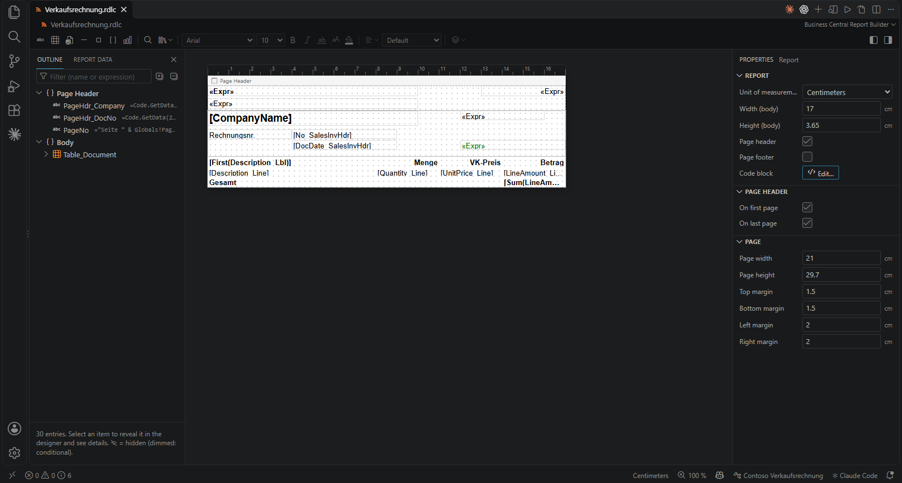
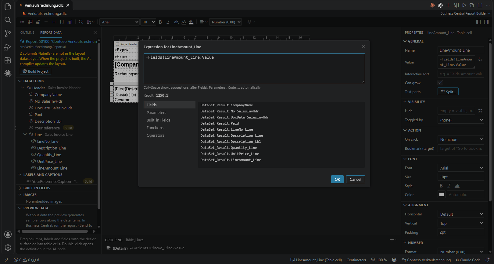
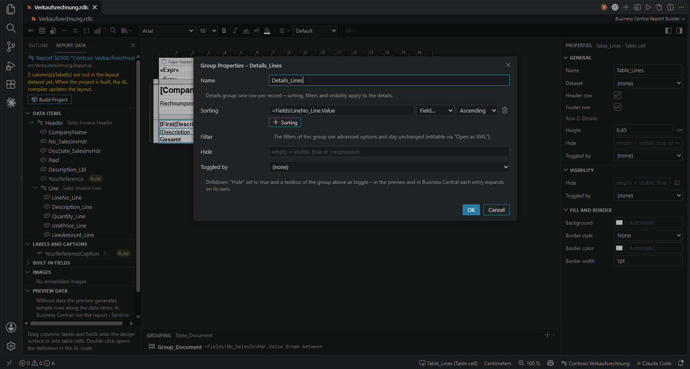
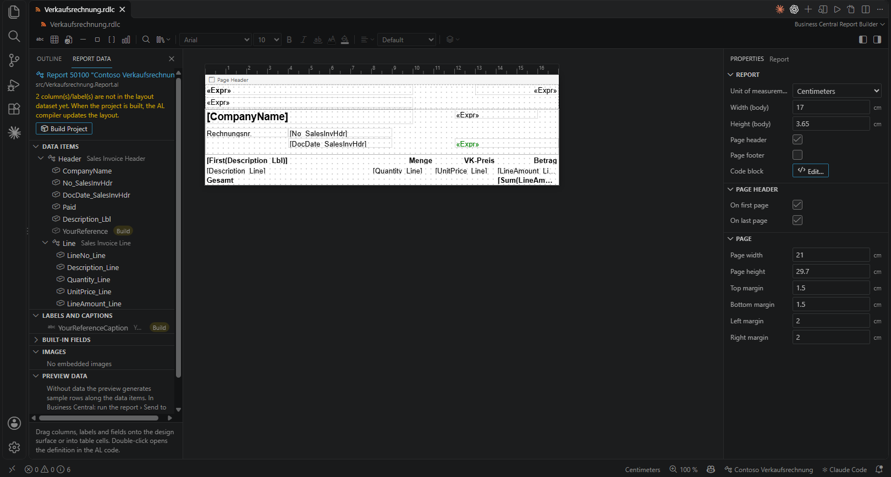
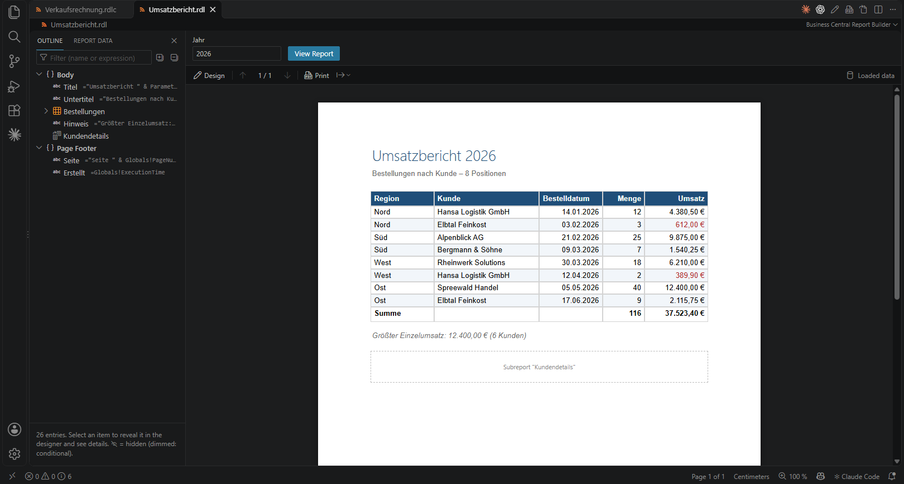
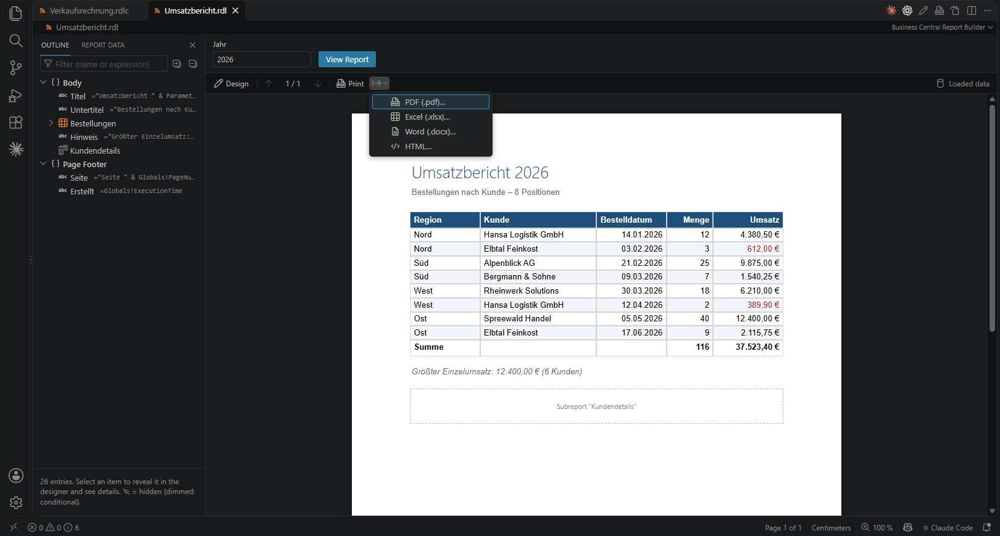

# Report Builder user guide

English | [Deutsch](ANWENDERHANDBUCH.md)

This guide covers **Business Central Report Builder for VS Code**: opening, designing, previewing and exporting
RDLC/RDL layouts. See the [migration guide](MIGRATION.md) if you are moving from standalone Microsoft Report
Builder, or the [AI tools guide](AI-TOOLS.md) for agent-assisted editing.

Applies to version 1.0.0, 21 October 2026. Screenshots show the English Windows UI and the repository's examples.
The UI follows VS Code's display language. Example file, dataset and field names remain unchanged across languages.

## Contents

- [Installation and first steps](#installation-and-first-steps)
- [The interface](#the-interface)
- [Editing a layout](#editing-a-layout)
- [Tables, groups and pages](#tables-groups-and-pages)
- [Business Central and AL](#business-central-and-al)
- [Loading preview data and checking results](#loading-preview-data-and-checking-results)
- [Exporting and printing](#exporting-and-printing)
- [Reuse, search and AI assistance](#reuse-search-and-ai-assistance)
- [Keyboard and troubleshooting](#keyboard-and-troubleshooting)

## Installation and first steps

For a guided introduction, run **Business Central Report Builder: Getting Started** in the Command Palette.
The walkthrough can open a separate copy of the revenue example with preview data. It lives in a temporary
folder; use **Save As…** to keep your changes. The walkthrough also opens this guide, the migration guide and
the AI tools guide offline. German UI languages open German guides; all other languages use English.

1. Install or open VS Code 1.95 or newer.
2. Download `bc-report-builder-<version>.vsix` from [Releases](https://github.com/strxngewxrld/report-builder/releases).
3. Open the Command Palette (`Ctrl+Shift+P`), choose **Extensions: Install from VSIX…** and select the package.
4. Open the project using **File › Open Folder…**. For Business Central, use the project containing `app.json`,
   AL source and layouts so the designer can find the owning report.
5. Open a `.rdlc` or `.rdl` file in Explorer. If it opens as XML, use **Open in Designer** in its Explorer context menu.

The Microsoft AL extension is not required for layout design and local preview. It is needed for AL development
and **Build Project (AL: Package)**. Building, downloading symbols and running in BC require a trusted workspace.

To explore the examples, open a copy of [samples](../samples):

- `Umsatzbericht.rdl` includes a data file and is suitable for your first preview.
- `Verkaufsrechnung.rdlc` belongs to `src/Verkaufsrechnung.Report.al` and demonstrates BC integration.
  Its dataset is intentionally outdated relative to AL, so a build marker is expected.
- `Bericht1.rdlc` is another layout example.

Create a layout with **New Report Layout…** in a folder's context menu, or **File › New File… › Report Layout
(RDLC)**. This creates the layout file. A BC layout must also be registered in the AL report;
see [Linking a layout and AL report](#linking-a-layout-and-al-report).

## The interface



The canvas shows **Page Header**, **Body** and, when present, **Page Footer**. Placeholders such as `[CompanyName]`
and `«Expr»` represent fields and expressions. Their evaluated values appear in preview.

| Area | Purpose |
| --- | --- |
| Outline, left | Find items, nested tables and groups; filter by name/expression; synchronize selection with the canvas |
| Report Data, left | Fields, labels, images and preview data; BC adds AL data items and the report's layouts |
| Toolbar above the canvas | Insert items, change fonts/number formats, arrange items, search expressions and insert blocks |
| Properties, right | Properties of the selection; with no item selected, report and page properties |
| Grouping, bottom | Groups and group properties of the selected table |
| Editor title and overflow menu | Design/preview, XML, insert, view, report properties and other commands |
| VS Code status bar | Selection, unit, zoom, owning AL report and current preview page |

Hover over icons for labels. Major actions are also in the Command Palette under **Business Central Report
Builder**. To make room, hide VS Code's sidebar with `Ctrl+B`, or toggle the internal panes through **View** in
the editor overflow menu.

## Editing a layout

### Text, position and formatting

1. Select a textbox on the canvas or in Outline.
2. Use **F2**, **Enter** or the context menu's **Edit Text** action.
3. Accept inline text editing with `Ctrl+Enter`, or cancel with `Esc`.
4. Set font, color, alignment and number format through the toolbar or Properties.
5. Drag the item or change its position and dimensions in Properties.
6. Save with `Ctrl+S`; undo a change with `Ctrl+Z`.

To insert an item, choose **Textbox**, **Rectangle**, **Line** or **Table**, then place it on the canvas. `Esc`
exits the insertion tool. Drag fields from **Report Data** onto the canvas or a table cell. For a logo, embed an
image under **Report Data › Images**, then drag it into the desired section.

Select several items and use **Align and Arrange** to align, match dimensions or distribute them. The first
selected item is the alignment reference. Control grid/snapping through **View**; hold `Alt` while dragging
to position freely.

### Expressions instead of literal text

Choose **Expression…** in a textbox's context menu, or edit its **Value** property. Expressions start with `=`:

```vb
=Fields!LineAmount_Line.Value
=Sum(Fields!LineAmount_Line.Value)
=Parameters!YourReferenceCaption.Value
="Page " & Globals!PageNumber
```

Names must exist in the layout. Use the appropriate group/dataset scope for aggregates. These examples illustrate
syntax; not every report contains these fields or parameters.



`Ctrl+Space` opens completion; suggestions also appear after `Fields!`, `Parameters!`, `Globals!`, `ReportItems!`
and `Code.`. The editor checks syntax and shows a live result. Check page-dependent expressions on actual
preview pages afterward.

For a textbox with differently formatted parts, use **Text Parts › Split…**, for example to make the page number
bold while keeping “Page ” regular. **Convert to Simple Textbox** combines the parts again.

## Tables, groups and pages

### Changing a table

Select a cell and open the **Table** context menu. Insert/delete columns and rows, merge/split cells and edit
groups there. Distinguish rows **inside** and **outside** a group: a detail row repeats per record, while a row
outside the detail group can hold a grand total.

Body cells can be merged horizontally. Select adjacent cells in one row. To create a matrix, use **Insert
Matrix…** with a row field, column field and value.

### Inserting charts

Choose **Insert Chart…** and configure type, category and value. For a regional revenue comparison, use `Region`
as category and `Sum(Fields!Umsatz.Value)` as value. Use **Chart Properties…** to adjust series, axes, title,
legend and labels. Multiple series can use different chart types and a secondary value axis. Compare preview
values with known totals. See the [README limitations](../README.md#limitations) for unsupported chart features.

### Grouping and totals

Example using `Umsatzbericht.rdl`:

1. Select a detail cell in the table.
2. Choose **Table › Group › Add Parent Group…**.
3. Group by `=Fields!Region.Value` and add a group header or footer.
4. Put `=Sum(Fields!Umsatz.Value)` into a group-footer textbox. In that scope it returns the regional total.
5. In **Grouping**, open the group's gear icon for **Group Properties…**. Check sorting, filters and, for a
   grouped member, page breaks.
6. Verify each group and the grand total in preview.



The screenshot shows the invoice's **detail group**: one row per record, sorted by `LineNo_Line`. A group based
on a field has additional grouping and break options. Existing advanced filters may be preserved and editable
only in XML. When deleting, deliberately choose between deleting **only the group** and **the group with its rows**.
For table headings, check the row properties **Repeat on Every Page** and **Keep with Group**.

### Page setup and breaks

Use **Report Properties…** or report properties with no item selected to set page size, margins and body width.
For A4 portrait, use 21 × 29.7 cm. Keep:

```text
Body width + left margin + right margin ≤ page width
```

Items must also stay within the body. Unexpected blank pages often result from excess width, protruding items
or explicit group/item breaks. Headers and footers consume space within the usable page height. Test
`KeepTogether`, repeated table headings and group breaks with enough records to span pages.

## Business Central and AL

### Linking a layout and AL report

The designer recognizes `rendering › layout › LayoutFile` and `RDLCLayout`, including report extensions.
For example:

```al
rendering
{
    layout(MeinLayout)
    {
        Type = RDLC;
        LayoutFile = './Layouts/MeinLayout.rdlc';
    }
}
```

The path is relative to the project root containing `app.json`. An isolated layout without a matching report
has no AL context. Check the open project folder and layout reference first.

### New fields and translatable labels



**Report Data** shows the AL report's data items and columns. Double-click a column to open its AL definition.
In the invoice example, `YourReference` and its caption have **Build** markers: they exist in AL but not yet in
the layout dataset.

To add a column:

1. Open **Add Fields as Columns…** on a data item.
2. Select table fields. The picker uses workspace tables and symbol packages in `.alpackages`.
3. Review the inserted AL column and run **Build Project (AL: Package)**.
4. Check the AL output and diagnostics for compiler success. Only a successful build updates the dataset.
5. Drag the column from Report Data onto the canvas or a table cell.

For a translatable heading, select a literal-text textbox and choose **Create AL Label…**. The designer creates
the AL label and replaces the textbox value with a parameter reference. Build afterward. Translations belong
in XLIFF files under `Translations/`, with `TranslationFile` enabled in the AL project.

Use existing `<Column>Format` fields for decimals; dragging fields applies them automatically. For headings with
`IncludeCaption`, use the generated `<Column>Caption` parameter. Rename through **Rename Column (AL and Layouts)…**
so AL and the related RDLC layouts are updated together.

### Checking the target system

**Run Report in Business Central** uses the environment from `.vscode/launch.json`, optionally after publishing.
For acceptance, select the intended rendering in BC and use real data to check document groups, language,
amounts, headers, breaks and fonts. Local preview approximates report execution and does not replace this check.

## Loading preview data and checking results

With the designer active, press `F5` or choose **Show Preview**. Without loaded data, preview generates example
rows. These help with design but do not prove that business totals are correct.

Under **Report Data › Preview Data**, or using **Load Preview Data (Excel, CSV, JSON)…**, select:

- Excel (`.xlsx`) or CSV with column headings matching dataset fields.
- JSON as an **array of objects** for the import dialog:

```json
[
  { "Region": "Nord", "Kunde": "Beispiel GmbH", "Menge": 2, "Umsatz": 123.45 }
]
```

Import saves the data next to the layout as `<LayoutName>.data.json`, replacing the `.rdl`/`.rdlc` suffix.
The saved file is keyed by dataset name, so its structure differs from the import file:

```json
{
  "Umsaetze": [
    { "Region": "Nord", "Kunde": "Beispiel GmbH", "Menge": 2, "Umsatz": 123.45 }
  ]
}
```

`Umsaetze` is the dataset name in `Umsatzbericht.rdl`. For multiple datasets, start import on the intended one.
For BC data, run the report and choose **Send to › Microsoft Excel Document (data only)**. Header/line records
and grouping keys must agree for a realistic document test.



The unchanged example has eight rows, total quantity **116** and revenue **37,523.40 €**, displayed as
**37.523,40 €** because its report language is German. The “Kundendetails” subreport appears as a placeholder:
local preview does not execute subreports. Set parameters and click **View Report** to apply them. Existing
drilldown and sorting actions can be used interactively.

Inspect every page for missing rows, incorrect groups, `#Error`, clipped text, overlap and blank pages.
Return using `F5` or **Design**.

## Exporting and printing



Open the export menu beside **Print** in preview, or use the corresponding Command Palette action.

| Output | Use and limits |
| --- | --- |
| PDF | Paginated output; text/borders/backgrounds are vectors, images/charts embedded |
| Excel | Continue working with data and tables; numeric values remain numbers, not a pixel-perfect layout |
| Word | Continue editing text and tables, not a pixel-perfect layout |
| HTML | Export the report to an HTML file |
| Print | Open the paginated preview in a browser, then print or save to PDF through the browser |

Install report fonts locally for PDF. The exporter embeds supported TrueType/OpenType font subsets when the
font license permits. Without a suitable font file, it falls back to standard PDF fonts with limited character
coverage. Open and inspect exported files before sharing them.

## Reuse, search and AI assistance

The **magnifier** opens **Expressions and Usages…**. Search/replace layout expressions with a before/after preview.
**Field and Label Usages** identifies items using a column/label; **Show in Layout** selects an item.

To reuse a company header or address block, select the items and choose **Save Selection as Block…**.
**Insert Layout Block…** opens the library; RDLC export/import shares blocks between profiles/users. The library
belongs to the VS Code profile. Check missing fields, labels and datasets before insertion and add them to the
target report. Blocks do not transfer AL datasets or data sources.

Copilot's agent mode can use the Report Builder tools, such as `#reportLayout` and `#previewReport`.
State the target file, requested change and acceptance criteria:

> Group the table in Umsatzbericht.rdl by Region, add regional totals and preserve the grand total.
> Use the Report Builder tools, validate the layout and show the result in the designer.

Check changes and compiler output yourself. AI text preview reports values but cannot establish page count or
overlap-free pages; use paginated designer preview. The [AI tools guide](AI-TOOLS.md) covers tool inputs,
examples, confirmations and complete workflows.

## Keyboard and troubleshooting

These shortcuts apply on Windows with the designer focused. Input fields keep their own text-editing behavior.

| Shortcut | Action |
| --- | --- |
| `F5` | Toggle design/preview |
| `F2` / `Enter` | Edit selected textbox |
| `Ctrl+Enter` / `Esc` | Accept/cancel inline text editing |
| `Tab` / `Shift+Tab` | Next/previous canvas item |
| Arrow keys | Move selection |
| `Alt+arrows` | Resize; add `Shift` for small changes |
| `Shift+F10` | Selection context menu |
| `Ctrl+S` / `Ctrl+Z` / `Ctrl+Y` | Save / undo / redo |
| `Ctrl+wheel` | Zoom |
| `Ctrl+Shift+P` | Command Palette |

On macOS, standard editing commands use `Cmd` instead of `Ctrl`.

| Problem | Check and resolve |
| --- | --- |
| Layout opens as XML | Use Explorer › Open in Designer; check extension installation/activation |
| Field missing or marked Build | Check AL column/layout reference, build and fix compiler errors |
| AL report not detected | Open the project with `app.json`; check `LayoutFile`/`RDLCLayout` and the file path |
| `#Error` or missing values | Check names/case, dataset, imported data and the Problems panel |
| Extra blank page | Check body width plus margins, protruding items and explicit breaks |
| Incorrect number/date formatting | Check report language, number format and BC format fields; UI language is independent |
| Build/BC action unavailable | Check workspace trust, AL extension and project/environment setup |
| Map or subreport placeholder | Local preview does not render maps or execute subreports; verify in the target system |
| Cannot edit Word/Excel layout | This designer edits `.rdlc`/`.rdl`; other layout types open in their own applications |

See [README limitations](../README.md#limitations) for further chart and VB report-code restrictions.
